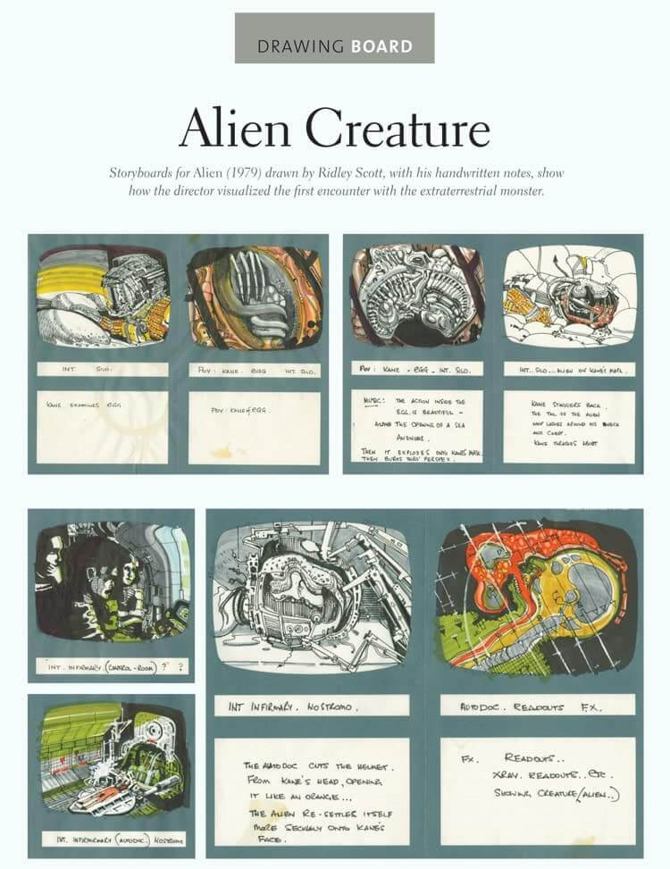

# 分镜案例（PDF 重新提取）

来源：SC Lannom / StudioBinder；用户提供的《46 Best Movie Storyboard Examples (Updated 2025).pdf》。页面署期为 2026-01-01，与文件名不同，保留此差异。

实际编号为 1–44；没有补造第45、46例。PDF中多数图片未加载，外链/视频不等于已包含的图像；已提取 Alien 实际分镜图。案例文字可检索，其余图像内容需查看原件确认。

## 1. Alien

来源：原 PDF 第 1 页。

Scene: Infirmary Scene

One of the great examples of storyboard use comes from Alien (1979). Ridley

Scott did not draw stick figures here, and while he probably picked up some

pretty slick storyboarding skills when he attended the Royal College of Art, it

doesn’t mean you should throw in the towel or that you can’t achieve similar

results.

This Alien storyboard is a great source of inspiration for storyboard techniques,

particularly for creating tension and atmosphere.

Example of storyboard  •  Alien by Ridley Scott

## 2. Pacific Rim

来源：原 PDF 第 1 页。

There are not many wide shots in these storyboards. Going from the control

room to the outside takes careful film planning. There is a distinct

Japanese/Anime vibe.

The use of negative space in this storyboard is similar to how light is used. The

entire storyboard, including shot specs, can be viewed below.

Check out these Pacific Rim storyboards

Whether you’re crafting a feature film, animation, or marketing video, a well-

planned storyboard is the key to seamless storytelling. This Pacific Rim

sequence is a perfect video storyboard example, showing how negative space

and shot transitions create tension and cinematic scale.

## 3. Jurassic Park

来源：原 PDF 第 1 页。

Scene: Raptor Attack Scene

The storyboarding notes help lead you into each new shot. Multiple slides (or

cells) can be used for a single shot, especially if you plan to linger. Notations

like 'foot toward the camera' demonstrate how to guide the viewer's eye.

Directional arrows and detailed shot descriptions ensure a smoother transition

between scenes, whether you're storyboarding a chase sequence or a product

demo.

Example of storyboard  •  Jurassic Park

In Jurassic Park, the raptor attack storyboard is a masterclass in visual

sequencing. It uses multiple slides to capture a single shot, with notes like “foot

toward the camera” helping guide the viewer’s eye. It’s one of the most vivid

examples of storyboard use that conveys both motion and suspense with

clarity.

## 4. Star Wars: A New Hope

来源：原 PDF 第 1 页。

Scene: A Galaxy Far, Far Away

George Lucas made a storyboard for the title sequence. C3PO looks different in

these. Tougher. Lucas knew how he wanted that final shot.

This Star Wars storyboard example shows how title sequences and character

framing establish mood. Storyboarding examples like this are not just for epic

space sagas—they’re essential for visualizing scenes in any genre, from intimate

dramas to high-octane action.

Film storyboard template  •  Star Wars: A New Hope

## 5. Transformers

来源：原 PDF 第 1 页。

Scene: Blackout’s Rampage

I quickly notice thoughtful sketches of the production design. See how the

artists visualize destruction? The blocking of the confused soldiers is

particularly interesting, making this both a compelling composition and a

beautifully crafted storyboard example.

Example of storyboard  •  Transformers

## 6. Inception

来源：原 PDF 第 1 页。

Scene: Hallway Fight Scene

Curious how to storyboard a rotating room?  The ceiling fan helps you stay

oriented. See how the room is drawn the same across multiple slides?

Techniques like these are often used in dynamic scenes—learn more in: How to

Storyboard a Fight Scene.

Planning camera movements, such as the rotation in the hallway fight, is

crucial for creating visually compelling action sequences.

Story board example  •  Inception

Note: The scene numbers were added by the storyboard artists.

The storyboard for the hallway fight scene in Inception shows how to map out

rotating rooms and camera movements. The ceiling fan appears across several

frames to anchor the audience’s orientation. It’s one of the top examples of

storyboard use that can control spatial logic in visually disorienting sequences

## 7. Edge of Tomorrow

来源：原 PDF 第 1 页。

Scene: Cage Drops In Scene

This storyboard shows a scene where Cage drops from the ship into battle.

While many films strive to make every moment feel heroic, this one excels at

capturing the chaotic unpredictability of battle.

Edge of Tomorrow  •  Storyboard Example

We get camera movement and an indication that this shot was meant to be

continued across multiple storyboard slides. Planning transitions like these are

essential for visual flow—learn more in How to Storyboard Camera Movement.

R E L AT E D  P O S T S

## 8. There Will Be Blood

来源：原 PDF 第 1 页。

Scene: Oil Derrick Scene

Film directors put significant thought into the background imagery, which

translates powerfully on screen. The scene features plenty of well-executed

shot-to-reverse-shot sequences.

## 9. American Beauty

来源：原 PDF 第 1 页。

Scene: Lester Bathroom Scene

The great thing about these storyboards from Sam Mendes' American Beauty is

that they describe more than just the shots, they establish the scene.

The "CUT TO:'s" give us a sense of how the scene will be edited, while

mentioning the steam coming out of the bathroom evokes the atmosphere.

Storyboards can be primarily a tool for a director to map out the shots but this

example shows us how they can also benefit collaborators like editor and

cinematographers.

Storyboards by Robin Richesson  • American Beauty stotryboard scene

Action-packed storyboard examples

## 10. Gladiator

来源：原 PDF 第 1 页。

Scene: Battle Tigers

Is there a clear chain of events in these storyboards? Intelligent camera

placement leads to depth and layers.

Storyboard Examples Gladiator Storyboard StudioBinder Storyboarding Software

Storyboarding these scenes beforehand is much cheaper than practicing with

real-life tigers. Less fun though.

## 11. Tomorrow Never Dies

来源：原 PDF 第 1 页。

Scene: Banner Escape

You should always storyboard stunts for extra safety. It will help your stunt

coordinators too. Costume designers decided to change both costumes.

Example of storyboard  •  Tomorrow Never Dies

## 12. Raiders of the Lost Ark

来源：原 PDF 第 1 页。

Scene: The Opening of the Ark

How does the color help tell the story, or communicate goals? Great use of

shading. Do you think this storyboard helped them light the scene?

Story board example  •  Raiders of the Lost Ark

## 13. Forrest Gump

来源：原 PDF 第 1 页。

Scene: Meet President Johnson

Robert Zemeckis combined custom footage with old newsreel footage. Covering

the scene in close-ups helped them shroud inconsistencies.

Here's what the storyboard would look like, frame-by-frame:

Storyboard Examples Forrest Gump Storyboard StudioBinder Storyboarding Software

## 14. Gone with the Wind

来源：原 PDF 第 1 页。

Scene: Fleeing Atlanta

Did the colors in the storyboard help with the lighting schemes later?

Storyboard notes help us understand the action. Lots of depth in slide three.

Storyboards by William Cameron Menzies for Gone With the Wind

## 15. Apocalypse Now

来源：原 PDF 第 1 页。

Scene: Ride of the Valkyries

The focus seems to be on how to shoot the air cavalry. Notice the carnage

behind Col. Kilgore. Do these helicopters look heroic? Evil? Neutral?

Storyboards by Alex Tavoularis  •  Apocalypse Now

## 16. Ali

来源：原 PDF 第 1 页。

Scene: Muhammad Ali vs. Ernie Terrell

Directional storyboard arrows show where punches come from. It is important

to replicate actual fights. A big wide establishing shot of the arena creates

scope.

Here's what the storyboard looks like:

Storyboard Examples Ali Storyboard StudioBinder Storyboarding Software

## 17. Spartacus

来源：原 PDF 第 2 页。

Scene: Battle Plans

How many storyboard battle scenes have drawn inspiration from Spartacus?

One slide is dedicated to arrows in mid-flight, showcasing dynamic motion.

These storyboard samples are rich in color and detail.

Example of storyboard  •  Spartacus

Interesting composition and angle choice.

## 18. The Towering Inferno

来源：原 PDF 第 2 页。

Scene: Elevator Rescue Scene

There are many high angles in this storyboard, adding scale and tension. In

complex stunt and VFX sequences, storyboards are essential for maintaining

consistency and guiding departments like cinematography and editing. Big

action scenes require careful planning to ensure seamless visual continuity.

Story board example  •  The Towering Inferno

Here we have a scene with stunts, special effects, and a difficult location.

## 19. Salt

来源：原 PDF 第 2 页。

Scene: Rooftop Scene

This storyboard depicts a scene where Salt hangs from a rope before letting go.

The artist’s use of composition and background imagery—such as cop cars and

the rock garden—adds depth and helps communicate key visual elements.

These details are crucial for other departments, ensuring consistency in set

design, VFX, and cinematography.

Storyboard Example - Salt Storyboard - Tim Burgard - StudioBinder

Storyboard Example by Tim Burgard

There are references to a camera pan with the rope swing as well.

## 20. Interview with the Vampire

来源：原 PDF 第 2 页。

Scene: Ending Scene

Spoiler: this storyboard shows the final scene where Lestat bites Mallory.

Interview with the Vampire Storyboard Example

Notice how the pacing of the scene is referenced in the storyboard notes. The

scene plays out a bit differently in the movie, which may have been done on

purpose or maybe the shot didn't work out as planned.

R E L AT E D  P O S T S

Musical Storyboard Examples

## 21. Austin Powers 3

来源：原 PDF 第 2 页。

Scene: Opening

When you're shooting a scene that incorporates stunts and a visual effect

component, it's super important to storyboard camera movement down to a

tee.

What is a Shot List Austin Powers Storyboard Example StudioBinder Storyboarding Software

Jay Roach had only eight hours to shoot one of the best opening sequences,

and you can see that it did not stop him from nailing down that task.

## 22. Moulin Rouge

来源：原 PDF 第 2 页。

Scene: Diamonds Are a Girl’s Best Friend

The use of directional arrows keeps us oriented. A POV shot of Sabine reaching

out is one slide that jumps out to me. Close-ups to wide shots.

Film storyboard template  •  Moulin Rouge

Baz Luhrmann uses lots of angle changes in this scene, and you can see the

complicated edit visualized during the storyboard process.

## 23. The Sound of Music

来源：原 PDF 第 2 页。

Scene: Do-Re-Mi

Lots of symmetry in these shots. A ton of complicated choreography. Great

depth in many of the slides due to creative blocking.

Film storyboard template  •  The Sound of Music

There is a fantasy element to how much ground they cover.

Horror Storyboard Examples

## 24. Get Out

来源：原 PDF 第 2 页。

Scene: Sunken Place Scene

This digital storyboard shows a scene where Chris falls into the sunken place

after being hypnotized by Missy Armitage.

Storyboard Example - Get Out Storyboard 2 - Eric Yamamoto - StudioBinder

Get Out Sunken Place Storyboard Example by Eric Yamamoto

Here's a continuation of this storyboard:

Storyboard Example - Get Out Storyboard - Eric Yamamoto - StudioBinder

Get Out Sunken Place #2 Storyboard Example by Eric Yamamoto

## 25. Psycho

来源：原 PDF 第 2 页。

Scene: Trouble in the Shower

The knife shot is the same in the film. Look at the intended close-up of her

mouth when she’s stabbed. Sex, comfort, and murder collide.

What is a Storyboard Psycho Storyboard Scene StudioBinder Storyboarding Software

A happy face in the first few slides marks a huge tonal shift in this scene.

Psycho  •  Trouble in the Shower

## 26. The Birds

来源：原 PDF 第 2 页。

Scene: Playground Scene

This storyboard example shows the birds gathering on the school playground

while the children are inside the school.

The Birds  •  Storyboard Example

This scene plays out differently in the actual film, but the overall purpose of the

storyboard is still very much present.

Children Get Attacked By Birds

R E L AT E D  P O S T S

Fantasy Storyboard Examples

## 27. Spider-Man 2

来源：原 PDF 第 2 页。

Scene: Train Battle

This storyboard looks like a comic book...Spidey is losing, then winning. Lots of

directional arrows.

Story board example  •  Spider-Man 2

We need at least three more Spider-Man reboots! I'd do another pithy

storyboard pun but Spider-Man is never sarcastic....

## 28. Logan

来源：原 PDF 第 2 页。

Scene: Decapitation Scene

This storyboard shows the scene where Logan decapitates Jackson. This is a

detailed storyboard example by a very talented storyboard artist.

Logan Storyboard by Mark Vena

There were a lot of brutal scenes throughout Logan, and the storyboard artist's

job was to capture the emotion in the sketch.

Logan  •  Trailer

## 29. Ant-Man

来源：原 PDF 第 2 页。

Scene: Ant Rescue Scene

Notice how storyboard artist Steven Markowski uses lines around Scott Lang’s

face to signal surprise. Storyboards don’t have to be static—small touches like

this add emotional and physical dynamics, making these 2D sketches feel more

alive and expressive.

Ant-Man Storyboard by Steven Markowski

## 30. Iron Man

来源：原 PDF 第 2 页。

Scene: Pepper Catches Tony Scene

This storyboard from Iron Man captures the moment Pepper catches Tony

trying to remove his suit after his first mission. Including bits of dialogue in the

notes can help contextualize key moments like this, adding clarity to character

interactions and ensuring the visual storytelling aligns with the script’s tone

and intent.

Storyboard Example - Ironman Storyboard - David Duncan - StudioBinder

Iron Man Storyboard Example by David Duncan

## 31. Harry Potter and The Order of the Phoenix

来源：原 PDF 第 2 页。

Scene: Battle at the Department of Mysteries

Directional arrows help keep us organized. High-angle shot when they enter

the Department. Slide two illustrates confusion.

Storyboards by Jim Cornish for Harry Potter and the Order of the Phoenix

Notice how it’s a point-of-view shot when Harry casts a spell.

Battle at the Department of Mysteries  •  Harry Potter and the Order of the Phoenix

## 32. Percy Jackson

来源：原 PDF 第 2 页。

Scene: Medusa Scene

This storyboard depicts Percy Jackson confronting Medusa, designed

specifically for an anamorphic aspect ratio. Storyboards should always be

framed with the final aspect ratio in mind, ensuring compositions translate

effectively to the screen.

Storyboard Example - Percy Jackson Storyboard - Tim Burgard - StudioBinder

Percy Jackson Storyboard by Tim Burgard

The storyboard example has sound effects added as well as detailed shot

descriptions that help tell the story through visuals.

Percy Jackson  •  Medusa Scene

R E L AT E D  P O S T S

TV Storyboard Examples

## 33. Game of Thrones

来源：原 PDF 第 3 页。

Scene: Daenerys Targaryen Give Birth Scene

This storyboard shows a scene where Daenerys gives birth to three dragons

which works out perfectly for everyone in the last season.

Daenerys Gives Birth Storyboard Example

## 34. Buffy The Vampire Slayer

来源：原 PDF 第 3 页。

Scene: Mouth of Hell

Parallel action occurs on the same storyboard. More depth with the wider

shots. Storyboards are great for any effects-heavy TV show or film.

This Buffy the Vampire Slayer storyboard example showcases how parallel

action can build suspense across different character arcs. This storyboard

example also illustrates the importance of balancing depth and action within a

single storyboard frame—something that works just as well for TV as it does for

social media storytelling.

Storyboards by Charles Ratteray for Vampire Slayer

You can start to see why Whedon was called on to direct The Avengers.

## 35. Westworld

来源：原 PDF 第 3 页。

Scene: Reckoning

Similar to the storyboard example above, you can show parallel action on a

single storyboard. Notice how important the arrows are in this storyboard and

how they inform the order of the edits.

Westworld Season 2 Storyboard Example by Dan Caplan

Here is the trailer from season 2 of Westworld:

Westworld  •  Season 2 Trailer

R E L AT E D  P O S T S

Animation Storyboard Examples

## 36. Kung Fu Panda

来源：原 PDF 第 3 页。

Scene: Training Scene

This animatic shows a scene where Po attempts Kung Fu training.

Kung Fu Panda Storyboard Example by Angelo Libutti

Because this is an animation storyboard the images you see in this example are

the actual building blocks for the final image. Animation projects like this are

excellent inspiration for storyboard creators who want to translate character

emotions and actions into compelling visuals.

Training Scene

## 37. Up

来源：原 PDF 第 3 页。

Scene: Opening Scene

This storyboard example from Up demonstrates the importance of layering

emotional beats into visual storytelling. Each frame provides a vivid visual

representation of the emotional highs and lows, guiding the audience through

the story seamlessly. This shows the opening scene in Up, which is super

uplifting and not painful at all.

Animators rely on iterative drafts to refine their storyboards, a process that can

also benefit educators by explaining complex ideas step-by-step.

Up  •  Storyboard Example

Again, because this storyboard was made for an animated feature film you can

see how closely the storyboard example is the final product.

Opening Scene from  •  Up

## 38. Tom and Jerry

来源：原 PDF 第 3 页。

Scene: Orphan Episode

Here you can see some of the earliest animation storyboard examples from an

episode of Tom and Jerry.

Tom and Jerry  •  Storyboard Example

## 39. Summer Camp Island

来源：原 PDF 第 3 页。

Scene: Witch Episode

This storyboard shows an important moment in the show where the youngsters

realize their camp counselors are witches. How fun!

Summer Camp Island  •  Storyboard Example

Check out the scene below to see how the storyboard leads to the final scene,

and how closely they resemble each other.

Summer Camp Island  •  Episode

## 40. Batman

来源：原 PDF 第 3 页。

Scene: Series Intro

This storyboard shows the introduction sequence for the Batman Animated

Series. Seeing these slides brings back sweet memories.

Storyboard Examples Batman Storyboard StudioBinder Storyboarding Software

There is no better clarification of how useful storyboards can be when you see

one from an animated film or television show. Animators often understand

visual literacy better than many film directors.

Batman Animated  •  Storyboard Example

## 41. Adventure Time

来源：原 PDF 第 3 页。

Scene: Tree Trunks Alien Scene

This storyboard example from the animated show Adventure Time shows how

you can add dialogue and screen direction to your animated storyboards to

make them as specific as needed.

Adventure Time  •  Storyboard Example

R E L AT E D  P O S T S

Video Game Storyboard Examples

## 42. Super Mario Odyssey

来源：原 PDF 第 3 页。

Scene: Game Intro Scene

The Super Mario Odyssey storyboard example highlights how video game

storyboards differ from films by focusing on player interaction and

progression. Storyboarding examples like this require special attention to

pacing and choice. Using storyboard software can help map out complex

interactive elements for your game.

This particular example allows you to play the game either as Mario... or as

Mario's hat, which is exactly as fun as it sounds.

Super Mario Odyssey Video Game  •  Storyboard Example

Storyboards can be used for film, television, animation, and video games

because they are the perfect tool for communicating visual goals.

Super Mario Odyssey  •  Intro

## 43. Gears of War

来源：原 PDF 第 3 页。

Scene: Mad World Trailer

This storyboard example shows the trailer for Gears of War. This trailer

featured the song "Mad World", and helped create a successful launch for the

series. The games are great, but no doubt the trailer helped a lot.

Gears of War  •  Storyboard Example by Dwayne Turner

This Gears of War storyboard is a strong video storyboard example,

illustrating how carefully planned visuals can elevate a game trailer into an

iconic cinematic experience. The use of music and mood-driven pacing

demonstrates the power of storyboarding in emotional storytelling.

Check out the trailer to see how the storyboard translated on screen:

Gears of War  •  "Mad World" Trailer

## 44. Major League Baseball

来源：原 PDF 第 4 页。

Scene: PS3 Move Trailer

This video storyboard example shows the trailer for Major League Baseball for

the PlayStation 3. This storyboard was created to show how the PS move

system could mentally transport players onto the field.

Major League Baseball  •  Storyboard Example by Dwayne Turner

Storyboards force creative filmmaking

Have you ever had a great idea for a shot or even an entire scene? Everything is

visualized perfectly in your mind, but will it make it to the screen?

What you need is a storyboard. This is what professional directors and

production companies use to communicate visual ideas with their teams.

In fact:

Cavemen used storyboards.

The Ancient Egyptians used storyboards.

Bottom line:  Storyboards work.

While some of the reasons storyboards work so well may seem painfully

obvious, there are more nuanced rationales that many novice (and

professional) filmmakers tend to overlook.

You may not have a huge budget, so naturally, you think you’re limited. That

line of thinking can be harmful to your project because what you’re doing is

limiting your creativity, which in turn limits the effectiveness of your vision,

which in turn limits your project.

Don’t waste valuable energy thinking about limitations. Take that energy and

create storyboard ideas for your scene (or look through websites where to find

storyboard artists for hire). Make sure to spend some time sketching out your

storyboard ideas, even if they're just samples. You’ll often hear the suggestion

to:

“Draw your storyboard ideas with stick figures if you’re not an artist.”

I strongly disagree.

Take your time to draw—even if it’s an ugly storyboard. Why? Because drawing

forces you to think critically about every detail:

An ugly background.

An ugly foreground.

Ugly characters.

Thoughtful shot compositions.

If you want to refine your skills, you can even explore Storyboard Classes

Online to build a stronger foundation.

Suddenly, new storyboard ideas are popping into your head:

Maybe a special easter egg is hidden in the background of a shot.

Or perfect symmetry for a specific point in the story.

Perhaps a match cut from one image to another.

These are all cinematic goals often born out of storyboarding. Directors like

Tim Burton and Wes Anderson excel at using precise shot composition and

unique production design.

They put imagery on the screen that doesn’t exist anywhere else in the real

world. Their teams built, scouted and pieced together a world that once existed

only in their minds.

How did they communicate their visions? Their teams used storyboards to

bring their ideas to life.

Learn as much as you can from these movie storyboard examples and see how

you can bring your dream from your head to the big screen.
